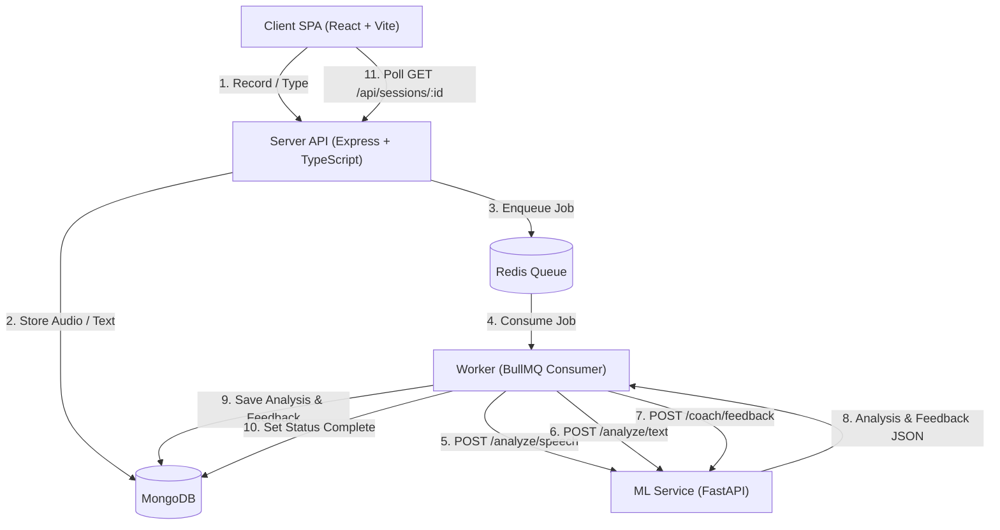

# PrepHelp Specification & Metric Formulas

## 1. System Overview
PrepHelp is an adaptive communication coach designed for placement-prep students practicing HR interviews, self-introductions, and speaking drills. The platform evaluates seven core dimensions:

1. **Speaking Pace** (WPM & articulation rate)
2. **Fluency & Hesitation** (Pauses, pause ratio, mean length of run)
3. **Filler Word Control** (Frequency, filler rate per minute, POS disambiguation)
4. **Grammar & Accuracy** (Errors per 100 words, syntactic agreement, tense consistency)
5. **Vocabulary Richness** (MTLD / MSTTR / TTR, CEFR level distribution, B2+ ratio)
6. **Response Structure** (Rule markers + 5-point rubric: opening, clarity, example, conclusion, coherence)
7. **Communication Confidence** (Transparent weighted composite indicator)

---

## 2. Metric Definitions & Mathematical Formulas

### 2.1 Speaking Pace
- **Total Duration ($T_{total}$)**: Timestamp of recording end minus start in seconds.
- **Speech Duration ($T_{speech}$)**: Sum of voiced speech segments detected via Voice Activity Detection (VAD).
- **Speaking Rate (WPM)**:
  $$\text{WPM} = \frac{N_{\text{words}}}{T_{\text{total}} / 60}$$
- **Articulation Rate (WPM)**:
  $$\text{Articulation WPM} = \frac{N_{\text{words}}}{T_{\text{speech}} / 60}$$
- **Pace Score (0-100)**:
  Target band: $120 \le \text{WPM} \le 160$ (configurable in `metrics.yaml`).
  $$\text{Score}_{\text{pace}} = \begin{cases} 
  100 & \text{if } 120 \le \text{WPM} \le 160 \\
  \max(0, 100 - (120 - \text{WPM}) \times 1.2) & \text{if } \text{WPM} < 120 \\
  \max(0, 100 - (\text{WPM} - 160) \times 1.2) & \text{if } \text{WPM} > 160 
  \end{cases}$$

### 2.2 Fluency & Hesitation
- **Pause Gap**: Silence between consecutive words $> 0.5\text{s}$.
- **Long Pause Gap**: Silence between consecutive words $> 1.5\text{s}$.
- **Pause Rate**: Pauses per minute of speech.
- **Pause Ratio**: $\frac{\sum \text{Pause Durations}}{T_{\text{total}}}$.
- **Mean Length of Run (MLR)**: Average count of words spoken uninterrupted between pauses.
- **Fluency Score (0-100)**:
  $$\text{Score}_{\text{fluency}} = \max(0, 100 - (\text{Pause Rate} - 12) \times 2.5 - (\text{Long Pauses} \times 8))$$

### 2.3 Filler Word Control
- **Monitored Fillers**: `um`, `uh`, `er`, `ah`, `like`, `you know`, `I mean`, `sort of`, `kind of`.
- **Heuristic for "like"**: Filtered using spaCy part-of-speech (POS) tagging. Only counted as a filler when tagged as a discourse marker/interjection (`INTJ`) and NOT when used as a verb (`VERB`) or preposition (`ADP`).
- **Filler Rate**:
  $$\text{Fillers Per Minute} = \frac{N_{\text{fillers}}}{T_{\text{total}} / 60}$$
- **Filler Score (0-100)**:
  Target: $\le 1.0 \text{ fillers/min}$.
  $$\text{Score}_{\text{filler}} = \max(0, 100 - (\text{Fillers Per Minute} \times 15))$$

### 2.4 Grammar & Linguistic Accuracy
- **Categories Tracked**: Subject-verb agreement, verb tense, article usage, pronoun case, modal verbs, prepositions.
- Speech transcripts filter out casing, punctuation, and typographical rules irrelevant to oral speech.
- **Errors Per 100 Words (EPW)**:
  $$\text{EPW} = \frac{N_{\text{grammar errors}}}{N_{\text{words}}} \times 100$$
- **Grammar Score (0-100)**:
  $$\text{Score}_{\text{grammar}} = \max(0, 100 - (\text{EPW} \times 12))$$

### 2.5 Vocabulary Range & CEFR Distribution
- **TTR (Type-Token Ratio)**: $\frac{V}{N}$ (unique lemmas over total words).
- **MTLD (Measure of Textual Lexical Diversity)**: Mean length of word sequences maintaining a TTR factor threshold of 0.72. Applied for $N \ge 50$; otherwise MSTTR/TTR is utilized with a `short_sample` flag.
- **CEFR Distribution**: Proportion of words classified into CEFR levels (A1-C2).
- **Vocabulary Score (0-100)**:
  $$\text{Score}_{\text{vocab}} = \min(100, (\text{MTLD} \times 0.6) + (\%B2+ \times 1.2))$$

### 2.6 Response Structure
- **Rule Markers (0-100)**: Presence of opening hooks, sequencing adverbs ("firstly", "subsequently"), concrete examples ("for instance", "specifically"), and conclusive summaries ("in summary", "ultimately").
- **LLM Rubric (0-20 mapped to 0-100)**: Evaluates opening clarity, thesis expression, supporting evidence, conclusion, and overall coherence (0-4 each).
- **Composite Structure Score**:
  $$\text{Score}_{\text{structure}} = 0.5 \times \text{Score}_{\text{rule}} + 0.5 \times \text{Score}_{\text{LLM}}$$
  *Note: If LLM is disabled or unavailable, `fallbackUsed = true` and $\text{Score}_{\text{structure}} = \text{Score}_{\text{rule}}$.*

### 2.7 Transparent Confidence Composite
The confidence metric is an explainable composite index:
- **Speech Mode**:
  $$\text{Confidence} = 0.25 \times S_{\text{filler}} + 0.20 \times S_{\text{pause}} + 0.20 \times S_{\text{pace}} + 0.15 \times S_{\text{pitch}} + 0.10 \times S_{\text{volume}} + 0.10 \times S_{\text{hedging}}$$
- **Text Mode**:
  $$\text{Confidence}_{\text{text}} = 0.40 \times S_{\text{hedging}} + 0.35 \times S_{\text{completeness}} + 0.25 \times S_{\text{repetition}}$$

### 2.8 Read-Aloud Alignment (WER)
For read-aloud prompts with a reference passage, alignment Word Error Rate (WER) is computed using Levenshtein distance on normalized word sequences:
$$\text{Accuracy} = \max(0, 100 \times (1 - \text{WER}))$$
Fillers and natural phrasing pauses are not penalized in read-aloud mode.

---

## 3. Architecture Diagram

